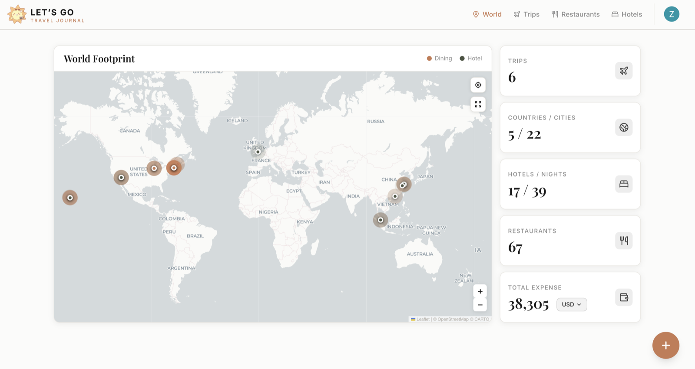

<div align="center">


# Let's Go — Travel Journal

**👉 Use it now: [letsgo-journal.vercel.app](https://letsgo-journal.vercel.app)**

[](https://github.com/zhenglin0619/letsgo/actions/workflows/ci.yml)
[](LICENSE)


### Every trip, every meal, every stay, on one map.

A personal travel journal for your trips, restaurants and hotel stays.<br>
Log your memories, see where you've been, and share trips with friends.



</div>

No download needed. It runs in your browser, and you can add it to your phone's home screen to use it like an app. Sign in with Google or email, then turn on **Demo Mode** in Settings to look around with sample data.

## Features

- **World map dashboard**: every trip pinned on an interactive globe or map, plus stats
- **Trips**: cover photos, country tags, and the restaurants and hotels from each trip
- **Restaurants**: dishes, ratings, Michelin stars, cuisine and photos
- **Hotels**: room details, price per night, and check-in/check-out dates
- **Photo uploads**: drag-and-drop, HEIC support, and dates and places read from photo EXIF data
- **Collaborators**: invite others to view and contribute to a trip or a single entry
- **Future plans**: a wishlist of trips, restaurants and hotels you want to try
- **Demo mode**: explore the whole app with sample data, without touching your own entries
- **English / 中文** interface, plus light and dark themes

## Tech stack

| Layer | Technology |
|---|---|
| Framework | Next.js 16 (App Router), React 19, TypeScript |
| Backend | Supabase (Postgres, Auth, Storage) |
| Styling | Tailwind CSS v4, Framer Motion, Radix UI |
| Maps | Leaflet + CARTO tiles, Google Maps / Places, Mapbox Search, react-globe.gl |
| Images | react-dropzone, heic2any, exif-js |

## Run it yourself

You only need this section if you want to change the code or host your own copy. To just use the app, open the link above.

Requirements: Node.js 20.9 or newer, and a [Supabase](https://supabase.com) project.

```bash
git clone https://github.com/zhenglin0619/letsgo.git
cd letsgo
npm install
cp .env.example .env.local   # then fill in your keys
npm run dev
```

Open http://localhost:3000.

### Environment variables

| Variable | Required | Purpose |
|---|---|---|
| `NEXT_PUBLIC_SUPABASE_URL` | yes | Supabase project URL |
| `NEXT_PUBLIC_SUPABASE_ANON_KEY` | yes | Supabase anon (public) key |
| `NEXT_PUBLIC_GOOGLE_MAPS_API_KEY` | yes | Google Maps JavaScript / Places API key, for address search |
| `NEXT_PUBLIC_CARTO_API_KEY` | no | CARTO Basemaps key for map tiles |

All of these are `NEXT_PUBLIC_*` variables, so they are built into the client bundle. When you deploy, set them in your hosting environment and rebuild. Restrict the Google Maps key to your own domains with HTTP referrer restrictions.

### Supabase setup

The app expects the following in your Supabase project:

- **Tables**: `trips`, `restaurants`, `hotels`, `future_plans`, `profiles`, `item_collaborators`
- **Storage bucket**: `photos` (public read)
- **Auth providers**: Email/password and Google

Turn on **Row Level Security** for every table. The anon key is public, so RLS policies are the only thing protecting user data.

## Project structure

```
src/
├── app/                 # Routes: dashboard, trips/[id], restaurants, hotels, privacy, terms
├── components/
│   ├── auth/            # Sign-in modal
│   ├── dashboard/       # World map and stats
│   ├── dining/          # Restaurant drawer and dish rows
│   ├── hotel/           # Hotel drawer
│   ├── layout/          # Navbar, FAB, root shell
│   ├── trip/            # Trip detail: banner, map, cards
│   ├── ui/              # Shared modals and inputs
│   └── upload/          # Add trip/restaurant/hotel modals
├── lib/                 # Supabase client, i18n, map tiles, image and format utils
├── store/               # Trips and language contexts, demo data
└── types/               # Shared TypeScript types
public/                  # Icons, PWA manifest, boot scripts
```

## Scripts

| Command | Description |
|---|---|
| `npm run dev` | Start the dev server |
| `npm run build` | Production build |
| `npm run start` | Serve the production build |
| `npm run lint` | Run ESLint |
| `npm run typecheck` | Type-check with `tsc` |

## License

[MIT](LICENSE) © Zhenglin Wang

Built with love by CX & ZW.
